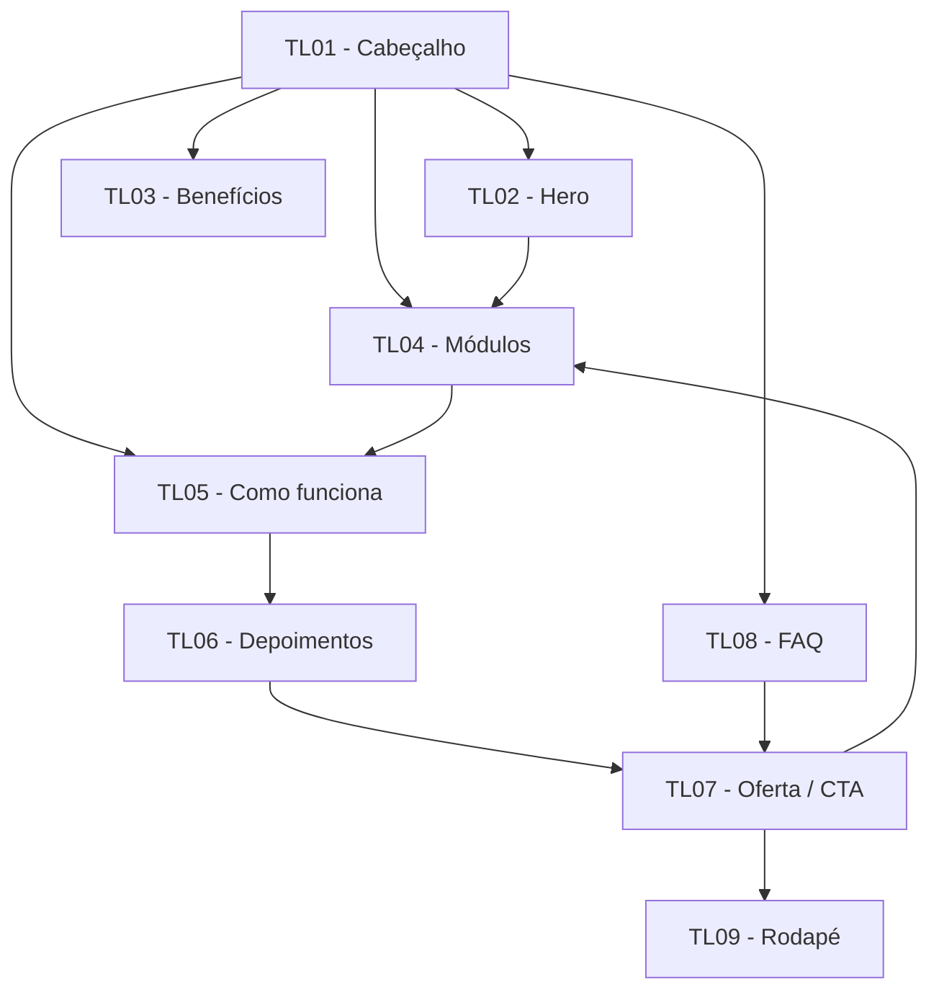

# Vocalis — Especificação de Design da Landing Page

> Documento de especificação para orientar a implementação da landing page do Vocalis em React. O projeto é acadêmico e apresenta um produto fictício. A página será client-side, sem backend, banco de dados ou integração com APIs.

## 1. Visão geral do projeto

### Nome do produto
**Vocalis**

### Proposta de valor
Uma experiência introdutória e acolhedora para quem quer explorar a própria voz e começar a aprender fundamentos do canto no seu ritmo.

### Problema e oportunidade
Pessoas iniciantes podem não saber por onde começar a aprender canto e podem sentir insegurança por não ter experiência musical. A landing page apresenta uma proposta simples, gradual e sem pressão, explicando o que a pessoa pode explorar e convidando-a a conhecer o conteúdo introdutório.

### Público-alvo
Pessoas iniciantes ou curiosas sobre canto e musicalidade, sem necessidade de experiência prévia. O conteúdo deve ser compreensível para quem ainda não conhece termos técnicos de música.

### Plataforma e escopo
- **Formato:** landing page de uma única página, com navegação por âncoras.
- **Tecnologias previstas:** React, CSS Modules e Javascript.
- **Execução:** client-side, com conteúdo estático/mockado.
- **Integrações:** não previstas.
- **CTA:** navegação simulada para seções da própria página.
- **Arquitetura:** MVVM
- **Repositório:** público no GitHub, conforme a atividade.

### Direção visual
A identidade deve transmitir acolhimento, expressão artística e descoberta. Usar fundo creme, vinho como cor principal, rosa queimado como acento e tipografia serifada nos títulos combinada a uma fonte sem serifa nos textos. Evitar aparência infantil, excesso de elementos decorativos ou uma estética de escola formal.

### Identidade verbal
**Slogan:** “Sua voz. Seu ritmo. Sua descoberta.”

## 2. Persona

### P01 — Pessoa iniciante em canto
- **Perfil:** pessoa que tem curiosidade sobre canto e música, mas ainda não sabe como começar.
- **Necessidades:** entender rapidamente a proposta, saber se o conteúdo é adequado para iniciantes e encontrar um primeiro passo claro.
- **Dúvidas prováveis:** “Preciso saber cantar?”, “Preciso ter um instrumento?”, “Quanto tempo preciso dedicar?”.
- **Implicações para o design:**
  - apresentar a proposta principal logo no primeiro bloco;
  - usar linguagem cotidiana e frases curtas;
  - destacar benefícios concretos sem prometer resultados garantidos;
  - organizar o conteúdo em etapas fáceis de compreender;
  - oferecer chamadas para ação visíveis;
  - explicar que a experiência apresentada é introdutória e demonstrativa.

> A persona é uma representação inicial do público pretendido, não resultado de pesquisa com usuários.

## 3. Design Tokens

### 3.1 Cores

| Token | HEX | Papel na interface |
|---|---|---|
| `cor-fundo` | `#F8F3EC` | Fundo principal creme |
| `cor-primaria` | `#742F43` | Títulos de destaque, botões principais e links ativos |
| `cor-acento` | `#D9A6A0` | Detalhes gráficos, realces e elementos decorativos |
| `cor-suporte` | `#E8D8C4` | Fundos secundários, cards e áreas de apoio |
| `cor-texto` | `#292523` | Texto principal |
| `cor-texto-inverso` | `#F8F3EC` | Texto sobre superfícies escuras, quando houver contraste suficiente |
| `cor-borda` | `#D8C9BC` | Bordas sutis e separadores |
| `cor-superficie` | `#FFFFFF` | Superfície alternativa de cards, se necessária |

**Orientações de uso**
- Priorizar `cor-texto` sobre `cor-fundo` para parágrafos.
- Usar `cor-primaria` com texto claro nos botões principais, verificando o contraste na implementação.
- Não usar `cor-acento` como cor de texto pequeno sobre fundo claro sem verificar contraste.
- O contraste final deve ser conferido para cada combinação utilizada. Meta: WCAG 2.1 AA, mínimo de 4,5:1 para texto normal e 3:1 para texto grande.

### 3.2 Tipografia

| Uso | Família sugerida | Peso | Tamanho de referência | Altura de linha |
|---|---|---:|---:|---:|
| H1 / título principal | Georgia | 700 | 40–56 px em desktop; 32–38 px em mobile | 1,1–1,2 |
| H2 / títulos de seção | Georgia | 700 | 28–36 px | 1,2 |
| H3 / títulos de cards | Georgia | 700 | 20–24 px | 1,25 |
| Corpo | Arial | 400 | 16 px | 1,5 |
| Texto auxiliar | Arial | 400 | 14 px | 1,45 |
| Botões e links | Arial | 700 | 14–16 px | 1,2 |

Os tamanhos são referências iniciais e podem ser ajustados durante a implementação para manter legibilidade e hierarquia visual.

### 3.3 Espaçamento, bordas e sombras

| Token | Valor | Uso |
|---|---:|---|
| `espaco-4` | 4 px | Ajustes mínimos |
| `espaco-8` | 8 px | Distância entre elementos relacionados |
| `espaco-12` | 12 px | Espaçamento compacto |
| `espaco-16` | 16 px | Espaçamento padrão interno |
| `espaco-24` | 24 px | Separação entre componentes |
| `espaco-32` | 32 px | Separação entre blocos |
| `espaco-48` | 48 px | Respiro entre conteúdos |
| `espaco-64` | 64 px | Separação entre seções |
| `raio-card` | 16 px | Cards e caixas de conteúdo |
| `raio-botao` | 999 px ou formato arredondado consistente | Botões e chamadas principais |
| `raio-imagem` | 16 px | Imagens e representações |
| `sombra-card` | Suave e discreta | Separar cards do fundo quando necessário |

Evitar sombras fortes, gradientes excessivos e excesso de contornos. Manter respiro visual entre as seções.

## 4. Tom de voz

| Atributo | Aplicação prática | Faça | Evite |
|---|---|---|---|
| Acolhedor | Reduzir a insegurança de quem está começando | “Você pode começar do seu jeito.” | “Você precisa ter talento para cantar.” |
| Encorajador | Valorizar a prática gradual | “Cada exercício é um novo passo.” | “Aprenda a cantar perfeitamente em poucos dias.” |
| Claro | Explicar a proposta sem jargões | “Explore sua voz e pratique os fundamentos do canto.” | Termos técnicos sem explicação |
| Artístico | Associar música à expressão pessoal | “Sua voz. Seu ritmo. Sua descoberta.” | Linguagem excessivamente corporativa |
| Honesto | Não apresentar o protótipo como serviço já operacional | “Conheça a proposta introdutória.” | Prometer aulas, resultados ou funcionalidades que não existem no protótipo |

### Exemplos de interface
- **CTA principal:** “Conhecer as aulas”
- **CTA secundário:** “Quero começar”
- **Estado vazio, se necessário:** “Ainda não há conteúdo adicional nesta demonstração.”
- **Aviso sobre conteúdo fictício:** “Este projeto é um protótipo acadêmico. Os módulos e depoimentos apresentados são ilustrativos.”

## 5. Componentes

### 5.1 Cabeçalho e navegação
- **Anatomia:** nome/logotipo textual Vocalis e links para seções relevantes.
- **Links sugeridos:** “Benefícios”, “Como funciona”, “Módulos” e “Dúvidas”.
- **Comportamento:** cada link navega até uma seção da mesma página por âncora.
- **Estilo:** fundo creme; logotipo em vinho; links com texto escuro.
- **Responsividade:** em telas estreitas, manter a navegação simples e evitar que os links ocupem toda a largura. Se não houver menu recolhível implementado, permitir quebra de linha sem sobreposição.
- **Estados:** padrão, hover e foco visível por teclado.

### 5.2 Botão / CTA
- **Anatomia:** texto de ação dentro de uma área clicável.
- **Variante principal:** fundo `cor-primaria`, texto `cor-fundo` ou outra cor clara com contraste validado.
- **Variante secundária:** fundo transparente ou `cor-suporte`, com texto `cor-texto`.
- **Tamanho:** altura mínima recomendada de 44 px; espaçamento interno confortável.
- **Estados:** padrão, hover, foco visível e ativo.
- **Comportamento:** navegar para uma seção existente, sem simular compra ou cadastro real.
- **Textos usados:** “Conhecer as aulas” e “Quero começar”.

### 5.3 Card de benefício
- **Anatomia:** título curto, descrição breve e, se necessário, uma representação visual simples.
- **Conteúdo:** “Explore sua voz”, “Desenvolva sua musicalidade” e “Aprenda sem pressão”.
- **Estilo:** superfície clara ou `cor-suporte`, cantos arredondados e sombra discreta apenas se necessária.
- **Estados:** padrão e foco/hover somente se o card for interativo. Não sugerir clique em cards que não tenham ação.

### 5.4 Card de módulo
- **Anatomia:** número ou marcador da etapa, título e descrição.
- **Conteúdo:** “Despertar a voz”, “Encontrar o ritmo” e “Cantar com confiança”.
- **Comportamento:** informativo, sem presumir que abre uma aula real.
- **Estilo:** usar o mesmo sistema visual dos cards de benefício.

### 5.5 Depoimento ilustrativo
- **Anatomia:** frase, nome fictício e indicação de conteúdo ilustrativo.
- **Conteúdo inicial:**
  - Marina: “Finalmente sei por onde começar.”
  - Lucas: “Aprender também é experimentar.”
- **Regra:** deixar explícito na seção ou próximo aos depoimentos que são exemplos fictícios criados para o protótipo acadêmico. Não apresentar como avaliações reais.

### 5.6 Bloco de oferta
- **Anatomia:** nome da oferta, resumo do que é apresentado e CTA.
- **Conteúdo:** “Plano introdutório gratuito”.
- **Comportamento:** CTA navega para a seção de módulos ou para outro destino presente na página. Não implementar cobrança, cadastro ou contratação real.

### 5.7 FAQ
- **Anatomia:** pergunta seguida de resposta.
- **Perguntas e respostas:**
  - **Preciso ter experiência com canto?** Não. A proposta é apresentar um caminho introdutório para quem está começando.
  - **Preciso de um instrumento?** Não para conhecer o conteúdo introdutório apresentado nesta demonstração.
  - **Quanto tempo preciso dedicar?** A proposta é praticar no próprio ritmo e adaptar o aprendizado à rotina.
  - **Como funcionam as aulas?** A página apresenta módulos demonstrativos; o protótipo não oferece aulas reais.
- **Interação:** pode ser texto aberto na página. Um acordeão só deve ser usado se for implementado com os recursos já estudados em aula.

### 5.8 Rodapé
- **Conteúdo:** “Vocalis” e “Sua voz. Seu ritmo. Sua descoberta.”
- **Complemento:** indicar que se trata de um projeto acadêmico fictício.
- **Comportamento:** sem links que levem a páginas inexistentes.

## 6. Telas e seções da landing page

A página é uma única tela longa, dividida nas seções abaixo. Como não foram fornecidos wireframes específicos do Vocalis, as orientações de layout são uma proposta de organização baseada no conceito definido, e não uma transcrição de wireframes.

### TL01 — Cabeçalho
**Objetivo:** identificar o produto e facilitar o acesso às seções.

**Layout, de cima para baixo**
1. Nome/logotipo textual “Vocalis”.
2. Navegação para as seções principais.
3. CTA “Conhecer as aulas”, se couber sem sobrecarregar o cabeçalho.

**Texto de interface**
- Vocalis
- Benefícios
- Como funciona
- Módulos
- Dúvidas
- Conhecer as aulas

**Componentes e tokens:** navegação, link e botão; `cor-fundo`, `cor-primaria`, `cor-texto`, `espaco-16`, `espaco-24`.

**Estados:** padrão, hover e foco visível.

**Navegação:** disponível no topo; links levam às seções correspondentes.

### TL02 — Hero / apresentação principal
**Objetivo:** explicar imediatamente a proposta do Vocalis e oferecer uma primeira ação.

**Layout, de cima para baixo**
1. Título principal e texto de apresentação.
2. CTA principal.
3. Imagem ou representação visual relacionada à voz, música ou expressão artística, sem sugerir que seja uma aula real.

**Copy**
- **Título:** “Sua voz merece ser descoberta.”
- **Descrição:** “Aprenda os fundamentos do canto, explore sua musicalidade e encontre novas formas de se expressar. Tudo começa com uma nota.”
- **CTA:** “Conhecer as aulas”

**Componentes e tokens:** título H1, parágrafo, botão principal e imagem; `cor-fundo`, `cor-primaria`, `cor-texto`, `cor-acento`, `espaco-24`, `espaco-48`.

**Estados:** conteúdo estático; imagem com texto alternativo descritivo.

**Navegação:** CTA direciona para TL04 — Módulos.

### TL03 — Benefícios e diferenciais
**Objetivo:** mostrar por que a proposta pode ser acolhedora para iniciantes.

**Layout, de cima para baixo**
1. Título da seção.
2. Três cards de benefícios, lado a lado em telas largas e empilhados em telas estreitas.

**Copy**
- **Título:** “Aprender música começa com você.”
- **Card 1 — Explore sua voz:** “Comece a perceber sua voz e descubra novas formas de se expressar.”
- **Card 2 — Desenvolva sua musicalidade:** “Explore ritmo, percepção e fundamentos musicais passo a passo.”
- **Card 3 — Aprenda sem pressão:** “Conheça uma proposta de aprendizado que respeita seu ritmo.”

**Componentes e tokens:** título H2, cards e texto; `cor-fundo`, `cor-suporte`, `cor-primaria`, `cor-texto`, `raio-card`, `espaco-24`.

**Estados:** cards informativos, sem clique se não houver ação.

**Navegação:** acesso pela navegação do cabeçalho; próxima seção é TL04 — Módulos.

### TL04 — Módulos / jornada de aprendizado
**Objetivo:** apresentar a sequência introdutória proposta.

**Layout, de cima para baixo**
1. Título da seção.
2. Três cards numerados, em sequência visual.
3. CTA para continuar explorando a página, se necessário.

**Copy**
- **Título:** “Uma jornada em três etapas.”
- **Módulo 1 — Despertar a voz:** “Conheça exercícios introdutórios de respiração e aquecimento vocal.”
- **Módulo 2 — Encontrar o ritmo:** “Explore noções de ritmo e percepção musical.”
- **Módulo 3 — Cantar com confiança:** “Conheça fundamentos de afinação e prática vocal.”

**Componentes e tokens:** título H2, cards de módulo, marcadores numéricos; `cor-fundo`, `cor-suporte`, `cor-primaria`, `cor-acento`, `raio-card`, `espaco-24`.

**Estados:** conteúdo estático e demonstrativo; não apresentar os cards como aulas acessíveis se elas não existirem.

**Navegação:** destino do CTA “Conhecer as aulas” do Hero.

### TL05 — Como funciona
**Objetivo:** explicar a abordagem em poucos passos.

**Layout, de cima para baixo**
1. Título da seção.
2. Três passos apresentados em sequência.
3. Texto breve de fechamento.

**Copy**
- **Título:** “Comece de onde você está.”
- **Passo 1 — Escolha seu ponto de partida:** “Conheça os fundamentos sem precisar ter experiência anterior.”
- **Passo 2 — Pratique uma etapa por vez:** “Explore os conteúdos de forma gradual.”
- **Passo 3 — Descubra novas possibilidades:** “Use a prática como espaço de expressão e descoberta.”

**Componentes e tokens:** título H2, blocos numerados e parágrafos; `cor-fundo`, `cor-texto`, `cor-primaria`, `espaco-24`, `espaco-32`.

**Estados:** conteúdo estático.

**Navegação:** acesso pela navegação do cabeçalho.

### TL06 — Depoimentos ilustrativos
**Objetivo:** mostrar exemplos de como a proposta pode ser percebida, sem alegar que sejam avaliações reais.

**Layout, de cima para baixo**
1. Título da seção.
2. Dois cards com frases e nomes fictícios.
3. Aviso discreto, porém legível, de que os depoimentos são ilustrativos.

**Copy**
- **Título:** “Aprender também é descobrir.”
- **Depoimento 1:** “Finalmente sei por onde começar.” — Marina
- **Depoimento 2:** “Aprender também é experimentar.” — Lucas
- **Aviso:** “Depoimentos fictícios, criados para este protótipo acadêmico.”

**Componentes e tokens:** título H2, cards de depoimento e texto auxiliar; `cor-suporte`, `cor-texto`, `cor-primaria`, `raio-card`, `espaco-24`.

**Estados:** conteúdo estático.

**Navegação:** seção informativa; não exige ação.

### TL07 — Oferta / CTA final
**Objetivo:** reforçar a proposta introdutória e oferecer uma próxima ação simulada.

**Layout, de cima para baixo**
1. Título de oferta.
2. Descrição breve.
3. CTA principal.

**Copy**
- **Título:** “Seu primeiro passo começa aqui.”
- **Oferta:** “Plano introdutório gratuito”
- **Descrição:** “Explore os fundamentos apresentados pelo Vocalis e descubra por onde começar.”
- **CTA:** “Quero começar”

**Componentes e tokens:** bloco de oferta, título H2, texto e botão principal; `cor-primaria`, `cor-fundo`, `cor-acento`, `raio-card`, `espaco-24`.

**Estados:** CTA navega para a seção de módulos ou para outro destino existente na página. Não simular contratação real.

**Navegação:** CTA direciona para TL04 — Módulos.

### TL08 — FAQ / dúvidas frequentes
**Objetivo:** responder às dúvidas básicas antes da ação final.

**Layout, de cima para baixo**
1. Título da seção.
2. Quatro perguntas com suas respostas.
3. Cada pergunta deve estar visualmente separada da seguinte.

**Copy**
- **Título:** “Dúvidas frequentes”
- **Pergunta 1:** “Preciso ter experiência com canto?”
- **Resposta 1:** “Não. A proposta é apresentar um caminho introdutório para quem está começando.”
- **Pergunta 2:** “Preciso de um instrumento?”
- **Resposta 2:** “Não para conhecer o conteúdo introdutório apresentado nesta demonstração.”
- **Pergunta 3:** “Quanto tempo preciso dedicar?”
- **Resposta 3:** “A proposta é praticar no próprio ritmo e adaptar o aprendizado à rotina.”
- **Pergunta 4:** “Como funcionam as aulas?”
- **Resposta 4:** “A página apresenta módulos demonstrativos; o protótipo não oferece aulas reais.”

**Componentes e tokens:** título H2, blocos de pergunta e resposta; `cor-fundo`, `cor-texto`, `cor-borda`, `espaco-16`, `espaco-24`.

**Estados:** respostas visíveis por padrão, a menos que seja implementado um acordeão com recursos estudados em aula.

**Navegação:** link “Dúvidas” do cabeçalho direciona para esta seção.

### TL09 — Rodapé
**Objetivo:** encerrar a página e reforçar a identidade do produto.

**Layout, de cima para baixo**
1. Nome “Vocalis”.
2. Slogan.
3. Identificação do projeto como protótipo acadêmico.

**Copy**
- Vocalis
- “Sua voz. Seu ritmo. Sua descoberta.”
- “Projeto acadêmico fictício.”

**Componentes e tokens:** nome do produto e textos; `cor-primaria`, `cor-fundo`, `espaco-16`, `espaco-24`.

**Estados:** estático.

**Navegação:** final da página.

## 7. Responsividade

Adotar uma abordagem mobile-first, usando CSS Modules e regras CSS comuns vistas em aula.

- **Mobile (até aproximadamente 767 px):** conteúdo em uma coluna; cards empilhados; títulos ajustados; botões com área de toque confortável; imagens sem ultrapassar a largura do conteúdo.
- **Tablet (aproximadamente 768–1023 px):** cards em duas colunas quando houver espaço; manter margens e espaçamentos consistentes.
- **Desktop (a partir de aproximadamente 1024 px):** conteúdo centralizado com largura máxima definida na implementação; hero pode usar texto e imagem em duas colunas; benefícios e módulos podem aparecer em três colunas.
- **Em todos os tamanhos:** evitar rolagem horizontal, sobreposição de textos e botões cortados. Os breakpoints são referências iniciais e devem ser validados visualmente.

## 8. Fluxo de navegação

A landing page usa navegação por âncoras, sem troca de rota.

**Comportamento dos CTAs**
- “Conhecer as aulas” → seção de módulos.
- “Quero começar” → seção de módulos.
- Links de navegação → seção correspondente.
- Nenhum CTA deve direcionar para uma página inexistente ou alegar que uma inscrição/compra foi concluída.

## 9. Acessibilidade

Checklist de implementação baseado em práticas WCAG 2.1 AA:

- [ ] Manter contraste de pelo menos 4,5:1 para texto normal e 3:1 para texto grande.
- [ ] Não comunicar informações apenas por cor.
- [ ] Usar estrutura semântica adequada: cabeçalho, navegação, conteúdo principal, seções e rodapé.
- [ ] Manter uma hierarquia coerente de títulos.
- [ ] Garantir foco de teclado visível em links e botões.
- [ ] Permitir navegação por teclado em todos os elementos interativos.
- [ ] Usar textos alternativos descritivos para imagens informativas; imagens decorativas devem ter tratamento apropriado.
- [ ] Usar rótulos compreensíveis para links e botões, evitando “clique aqui”.
- [ ] Manter área de toque recomendada de pelo menos 44 × 44 px para ações principais.
- [ ] Verificar que a página permaneça legível com zoom e em telas estreitas.
- [ ] Identificar os depoimentos como fictícios de forma perceptível.
- [ ] Respeitar a preferência por movimento reduzido caso sejam adicionadas animações; animações não são necessárias para a versão inicial.

## 10. Requisitos funcionais do protótipo

| ID | Requisito | Critério de aceite |
|---|---|---|
| RF01 | Apresentar a identidade do Vocalis | Nome, slogan, cores e tipografia aparecem de forma consistente |
| RF02 | Explicar a proposta do produto | Hero comunica o propósito e o público iniciante |
| RF03 | Apresentar benefícios | Três benefícios estão disponíveis em seção própria |
| RF04 | Apresentar módulos | Três etapas introdutórias são exibidas |
| RF05 | Explicar como funciona | A página apresenta a sequência em três passos |
| RF06 | Apresentar prova social ilustrativa | Dois depoimentos fictícios aparecem com aviso de que são ilustrativos |
| RF07 | Apresentar oferta | A oferta introdutória está visível e identificada como parte do protótipo |
| RF08 | Responder dúvidas frequentes | Quatro perguntas e respostas estão disponíveis |
| RF09 | Permitir navegação interna | Links do cabeçalho e CTAs levam às seções corretas |
| RF10 | Adaptar o layout a diferentes telas | Conteúdo não sobrepõe nem ultrapassa a largura da tela em mobile, tablet e desktop |

## 11. Lacunas do briefing

Os itens abaixo precisam ser confirmados ou definidos durante a implementação. Não devem ser tratados como funcionalidades já existentes.

1. **Arquitetura React:** confirmar qual das arquiteturas ensinadas será utilizada: MVVM ou FSD.
2. **Logotipo final:** há uma direção visual sugerida, mas o desenho definitivo do logotipo ainda não foi especificado.
3. **Imagens:** escolher as imagens ou representações visuais finais e garantir que sejam adequadas ao conceito.
4. **Interação do FAQ:** definir se as respostas ficarão sempre visíveis ou se haverá acordeão. A versão simples recomendada mantém as respostas visíveis.
5. **Destino do CTA:** a versão inicial usa âncoras internas. Cadastro, compra ou acesso a aulas reais não fazem parte do escopo definido.
6. **Validação de contraste:** conferir as combinações de cores efetivamente usadas no código.
7. **Conteúdo final:** revisar os textos depois de visualizar a página implementada.
8. **Pesquisa com usuários:** não foram fornecidos resultados de entrevistas ou testes; a persona e as decisões de design são hipóteses iniciais.
9. **Referências externas:** não foram definidos sites de referência específicos para o Vocalis.
10. **Detalhes de integrantes e turma:** preencher no README do repositório conforme a entrega acadêmica; não são necessários para o funcionamento visual da landing page.

## 12. Fora do escopo

- Backend, banco de dados e integração com APIs.
- Cadastro ou autenticação real.
- Pagamento ou contratação real.
- Aulas reais, reprodução de conteúdo didático ou acompanhamento de progresso.
- Depoimentos reais.
- Rotas para páginas que não fazem parte da landing page.
- Bibliotecas adicionais não apresentadas em aula.
